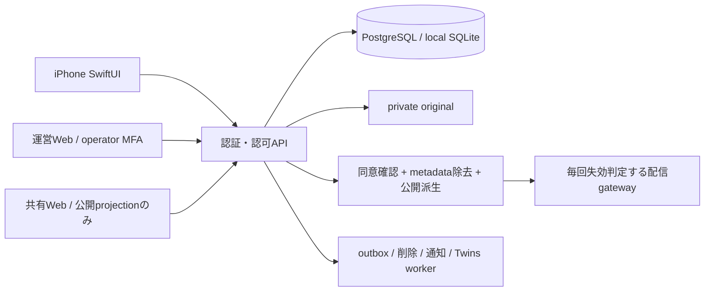

# ADR-001 技術構成（採択：Phase 0/1ローカル構成）

| 案 | iPhone操作性 | 安全性・保守 | 費用/撤退 | 判断 |
|---|---|---|---|---|
| A SwiftUI + Python API + PostgreSQL + 管理OIDC認証/画像保存 | PhotosPicker/共有/VoiceOverを標準利用 | 公開判定をAPIとDBに集約。iOS/APIの2言語が必要 | ローカルは無料、SQLと標準HTTPで移行可能 | 採用 |
| B クロスプラットフォームJS + ドキュメントDB一体BaaS | iPhoneのみには余分な抽象化 | ネイティブ連携と複数権限ルールの検証が増える | 開発初速はよいがDB/画像権限移行が複雑 | 今回不採用 |

iOS17+ SwiftUI。Phase 0/1は外部依存なしのXcodeプロジェクト、オフライン試作。写真は選択分だけ端末内メモリに保持し、アプリ終了後の保存はPhase 2。
Python標準ライブラリHTTP/SQLiteは**開発モック専用**。Pillowはテストイラスト作成時のみ、アプリ/API依存なし。
本番候補：SupabaseのPostgreSQL/Auth/private Storage + APIの認可層。まだ接続・契約しない。Python本番APIはASGIへ差し替え、JWT issuer/audience/期限/失効・運営MFAを検証。stdlib HTTPを本番に使わない。
検索は初期SQL名前検索、Twinsはfixture検索。後に端末/専用workerの画像embedding+pgvector候補を実測比較し、外部AIへの写真送信は同意/処理条件が確定するまで禁止。
管理Web/共有Webは独立公開面。管理APIはoperator roleと監査必須。Phase 0/1は管理デモ一覧・共有非公開終了ページの骨格のみ。
通知はAPNs候補（資格未提供）、アプリ内通知はDB/outbox。計測は許可した分類値・時間/件数のみ、写真や自由文をイベントに入れない。
CIはPython unit/API試験とmacOS Xcode build/unit試験。GitHubへpushやActionsの実行は未実施。

運営内部識別・証跡は公開レスポンスに載せない。共有URLのランダム性だけに依存しない。失効後はgateway/索引/通知/派生/キャッシュを連動。Phase 0/1には公開操作を実装せずfail closed。

## Phase1更新
Swift側のTwinsはApple Visionのfeature print revision1で端末内比較。デモ素材の同種だけ、同一/重複を除外、暫定距離閾値と最大3件。百分率は非表示。距離閾値はconfig/prototype.jsonに集約し、犬猫の似ている品質を保証しない。
犬猫自動検出/顔選択/実写真評価は未実装。本人の種別選択で試作できる。API/Web側はfixture検索のままでiOS実装と混同しない。
[Apple feature print公式](https://developer.apple.com/documentation/vision/vngenerateimagefeatureprintrequest) / [公式サンプル](https://developer.apple.com/documentation/vision/analyzing-image-similarity-with-feature-print)

## 2026-10-09: Twins初期方式の修正

iOS 27 SimulatorのVision revision2/CPUで、異なる所有イラストが同じ特徴値になる現象を追加試験で確認。単独成功を実写真の品質合格とは扱わない。初期比較を端末内の32×32 sRGB色・局所輪郭記述へ変更した。入力原本の送信なし、候補最大100、画像は順次読み、選出3件のみ表示、完全同一画素/近重複の除外、割合表示なしを維持。方式は画面で明示。学習済みPet類似モデル/犬猫認識ではなく、実写真精度は許諾された独立評価集合と利用者基準による測定・承認待ち。失敗証拠p1-stream-unit/normalizedと診断を保存する。
