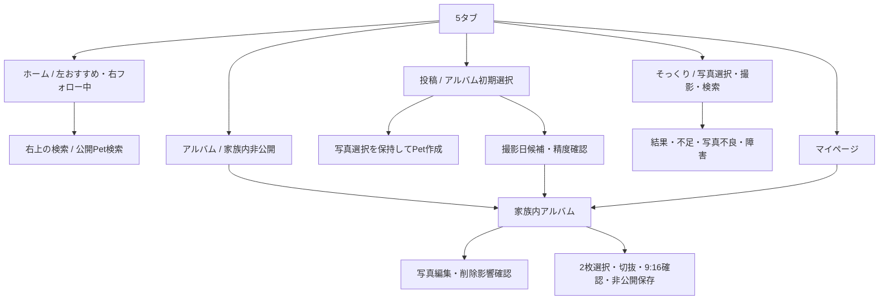

# 画面・状態の追跡

2026-10-09時点。参考UI10枚に対応する画面・状態を実装し、端末内・ローカルAPI・承認済みクラウド検証環境を使い分けている。画面の描画確認と製品機能の完了は区別する。ホームは左「おすすめ」が初期選択、右「フォロー中」。

| 画面ID | 正常 | 読込/空/エラー/権限/切断の方針 | 状態 |
|---|---|---|---|
| ONB / AUTH | 導入・認証方法・招待・ゲスト開始 | 取消/失敗で元画面へ | UI実装。検証用メール認証接続済み。Apple/Google・新規登録・年齢確認・引き継ぎは未完了 |
| HOME-01 | 左おすすめ/右フォロー中/詳細 | 0follow案内、fetchretry、私的画像なし | UIと実ローカルAPI接続。クラウドSNSは別の検証画面。本番統合未完了 |
| MY-01 | 所有Pet/参加album/save/設定/見る専用 | 閲覧者0Petも利用可 | 両表示UI、実ローカル件数・フォロー・保存を反映。本アカウント統合は未完了 |
| PET-01/02 | 非公開作成/編集・カバー/アイコン | 名前/種別/上限、任意情報の検証 | 端末内で編集・性別・誕生日・同Pet写真選択を保存。クラウドでの全任意情報編集は未完了 |
| PET-03 | 公開項目だけ | 停止/ブロック/元写真非公開 | 公開Pet UI・クラウド公開設定UIと明示確認。公開プロフィールの全項目は未完了 |
| ALB-01〜03 | 時系列/不明/節目/追加 | PhotosPicker読込/成功保持/失敗再送/重複確認 | 端末内記念日保存、検証クラウド30枚・部分再試行。終了後の再送キューなど未完了 |
| FAM-01/02 | 招待・承認・一覧・QR・記録 | 期限/取消/解除/退出deny | 招待・参加・一覧・解除の検証接続。活動イベント配信・正式リンク運用は未完了 |
| MEM-01/02 | 同月日の振り返り/2枚比較 | 日付不明を同日扱いしない、外部操作は別同意 | 端末内UI・比較保存。クラウド比較・外部共有未完了 |
| POST-01 | 4枚/500字/明示公開 | family actor禁止、提供者同意未成立deny | 投稿入口/写真選択/確認UIと検証環境接続。通常ホーム統合・複数Petタグ等は未完了 |
| COM-01 | 返信1階層/名義/通報 | block/停止/別Pet迂回deny | UI・実クラウド接続を検証。全受け入れシナリオは未完了 |
| TW-01〜05 | 入力/切り抜き/主・補助/不足/履歴 | 状態別表示、入力保持retry、最大3候補 | UI・端末内所有デモ・非公開履歴。実写真の判別/類似品質とクラウド候補登録は未完了 |
| WEB-TW/MEM | 有効公開projectionだけ | 失効は終了表示、原本URLなし | ローカル失効骨格。公開Web/OGP/Universal Links未完了 |
| SRCH / NTF / SET | 公開検索/通知/同意/データ/退会 | private/停止/block除外、拒否でも利用可 | UI・公開検索・実アプリ内通知。設定RPC適用・プッシュ・退会全削除未完了 |
| OPS-01 / OPS-SEED | 通報/異議/一括Pet/素材/予約/停止/監査 | roles/MFA/権利/競合/冪等性 | ローカルSEED・クラウド運営MFA境界を検証。クラウドSEED全運営・人間の権限設定等未完了 |

VoiceOver/Dynamic Type/色以外の公開文字/44pt操作/画像ラベルを設計。実サイズ/実機確認は別証拠へ。ダークモードは試作をLight固定し、読めなくなる配色切替を避ける。独自ダーク配色は未対応。

## 2026-10-10 ナビゲーション更新

下部はホーム・アルバム・投稿・そっくり・マイページの5タブ。中央投稿は48ptの円形ボタン。ホーム上部中央に18ptのMEFRION、右上に検索と通知を表示する。左おすすめを初期選択、右フォロー中とし、両方を大きな写真の縦フィードにする。見つけるの検索・カテゴリ・公開Pet候補は右上の検索から開く。アルバムタブは閲覧権限のあるPet一覧から非公開アルバムへ移動する。

上記表は2026-10-09の履歴を含む。最新の機能完了範囲と情報待ちは [P0/P1記録](../evidence/P01-COMPLETION.md)、今回の画面検証は [5タブ検証](../evidence/FIVE-TABS-HOME.md)を参照。

### 同日追加: 表示領域の調整

ホームは安全領域直下へ移動、見出し間隔4pt、切替文字13pt/行44pt。下部は52pt（中央＋36pt）。ゲストのログイン案内はフォロー中だけ。そっくりの重複する上部ナビゲーションを除去。[余白調整の検証](../evidence/COMPACT-LAYOUT.md)。

2026-10-17: 通常のそっくり画面は「写真を選ぶ」「写真を撮る」「この写真で検索する」を主操作にし、犬・猫は端末内で自動判定する。結果は大きな写真と小さな入力写真を先に表示。候補の出典は撮影者リンクで示し、履歴・共有・写真調整・削除・機能説明は右上の「その他」にまとめる。[画面と試験記録](../evidence/TWINS-SIMPLE-UI-20261017.md)。
