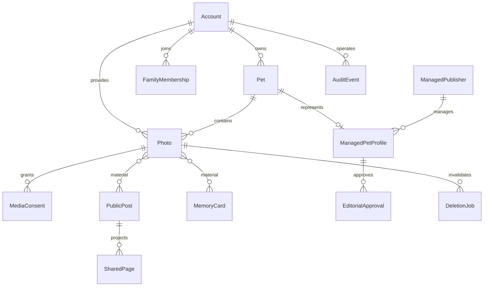
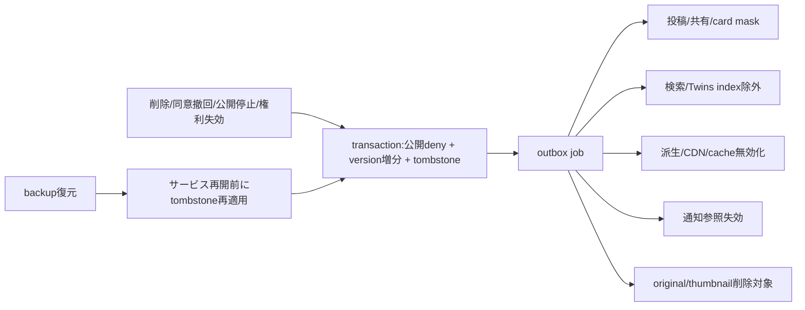

# 権限・同意・削除設計
人間Accountが認可主体。Petは表示名義。ManagedPublisherは編集主体であり通常Identityではない。operatorの編集/承認/配信権限は分離する。
管理者は全写真を編集でき、家族は自分の写真のみ。運営roleでも家族アルバムへの任意アクセスを認めない。
公開判定は owner操作 + Pet公開 + 写真ごとの提供者外部同意 + 有効な権利 + moderation + block を毎経路で評価する。

目標：認可/公開projectionは変更commit直後失効。物理ファイル/バックアップ完了時間は未確定・承認待ち。失効を再公開で自動解除しない、素材と承認versionを再検査する。
保存期限は未承認。削除Jobの再試行と検証、事故復旧演習をPhase4で実装する。
Phase0/1：外部公開APIなし、HTTPはloopbackのみ、固定demo bearerは本認証ではない。本番モード起動を拒否。写真取り込み・カードはローカル非公開、画像を外部AIへ送らない。
ログはaccess body/token/path ID/写真/コメントを出さず、分類した結果と時間だけ。demo HTTPに本物の写真を投入しない。実写真の本保存はPhase2まで未対応。
